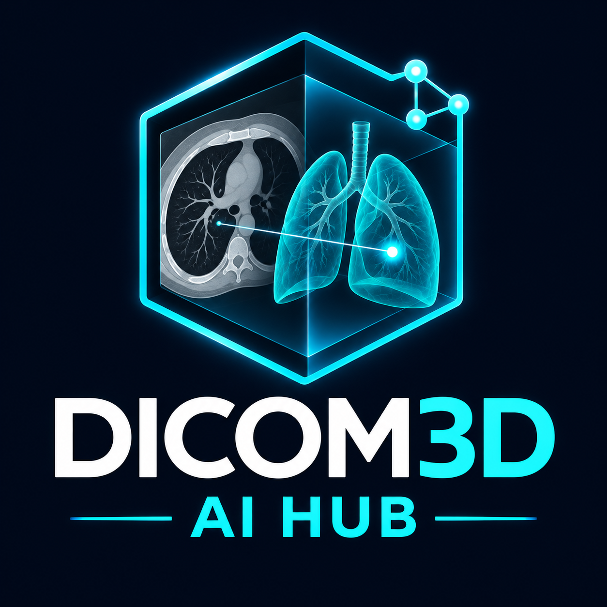

# DICOM3D AI Hub

**[Interactive Safe Demo](https://kennethjsmithdev.github.io/DICOM3D_AI/)** · **[Media gallery](https://kennethjsmithdev.github.io/DICOM3D_AI/gallery/)** · **[Installation](contest/build154/README.md#install-and-run)**

> This contest edition demonstrates DICOM3D's native InterSystems AI Hub interoperability workflow using the previously qualified Babylon Lite imaging interface. The broader DICOM3D platform continues independently with its Three.js/R3F-based v0.7.0-alpha.1 research prerelease.

**[Contest installation and demonstration](contest/build154/README.md)** · **[Native agent source](contest/build154/src/Native005.Operation.cls)** · **[Broader platform prerelease](https://github.com/KennethJSmithDev/DICOM3D/releases/tag/v0.7.0-alpha.1)**

  

This contest edition demonstrates a bounded decision-making task: an IRIS Interoperability production uses native `%AI.Agent` to explain a recorded public-research segmentation finding, retrieve restricted FHIR R5 evidence, validate its exact references and select the corresponding lesion in the imaging viewer. A synthetic source-identity mismatch requests review instead of inventing a correction.

**For reviewers:** [Follow the judge walkthrough](docs/JUDGE-WALKTHROUGH.md) for the native decision, exact citations, visible selection, and synthetic mismatch. The [Safe Demo](https://kennethjsmithdev.github.io/DICOM3D_AI/) is an immediately interactive **simulation**; the native workflow runs separately after local installation.

The integration reuses DICOM3D's existing Babylon Lite interface. The viewer alone is not the contest agent; the observable native evidence/decision/validation workflow is the contest-specific improvement. DICOM3D as a broader project predates the contest.

Start with the [portable packet instructions](contest/build154/README.md#install-and-run). No private patient data, model weights, credentials or restricted IRIS image are included. The approved public H000 research example is explicit. Authorized Community AI Hub Build154 acquisition and separately supplied model weights are prerequisites. Local fixture authentication is not a production clinical authorization system. This is a research prototype, not diagnosis or clinical deployment.

**Qualification status:** The native explanation/validated lesion-selection and synthetic mismatch paths were demonstrated on the earlier frozen packet. This male-only source derivative has a different packaging identity. Intermittent CPU inference failures remain unresolved, and a five-run repeatability gate was not completed. Read the [tested scope and known limitations](contest/build154/README.md#tested-scope-and-known-limitations) before installing or demonstrating.

The male-only derivative has subsequently completed a fresh isolated Build 154 and FHIR R5 startup, production start/stop, nine-resource readback and authorization-denial checks using the historical pinned model. No new inference was run in that startup check. The [runtime guide](contest/build154/docs/RUNTIME.md) documents the exact model and image identities; this historical fixture is not a claim of general provider support.

**Local runtime safety:** The frozen `contest.py stop` command invokes an unscoped IRIS production shutdown. Never use it when production ownership is uncertain or another production may have replaced the original; require manual, operator-supervised shutdown and recovery in that situation. This warning supersedes the frozen installation guide's statement that Stop acts only on owned resources. Loopback HTTP Basic authentication does not establish the listener’s identity, so use the workflow only on a trusted local host.

The imaging agent uses its restricted native toolsets in-process. A separate historical Build 154 test qualified authenticated MCP with synthetic tools, but this repository does not yet provide a DICOM3D-specific authenticated MCP endpoint.

## IPM package

The IPM module installs the native contest workflow classes. The viewer, FHIR service and model require separate setup. See the [IPM guide](docs/IPM.md); installation from the public registry by package name has not yet been verified.

The **0.2.0 source** also includes independently scoped FHIR CapabilityStatement-to-OpenAPI and synthetic message-metadata examples, plus optional local test-plan tools. See the [research additions](docs/IDEAS.md) for the exact scope, attribution, and limitations. These examples do not alter the native agent or establish a clinical, live-server, or provider-reliability qualification. DICOM and longitudinal research remain separately labeled in [the Ideas overview](ideas/README.md).

The source also contains an **experimental, opt-in H000 evidence fixture**. Its R4 and R4B selected-field representations are derived from the retained R5 research fixture and remain review-only; they are not original records from R4 or R4B servers. A controlled R5 research witness used the installed 0.2.0 native classes, checked source identities and produced a validated agent decision that selected the initially unselected lesion in a headed viewer. The private test used a separately configured bridge and the Safe Demo viewer; the public demo remains simulated. The model copy matched its pinned hash before and after this run. A previous copy showed a transient mismatch whose cause remains unknown. One witness does not establish clinical validity, repeatability, general FHIR conformance or production security. The fixture, model, relay and viewer require separate setup; the experimental operation does not replace the historical native workflow. See the [versioned evidence notes](ideas/fhir-versioned-evidence/README.md).

## Safe Demo

The [Safe Demo source](contest/safe-demo/README.md) builds a standalone, browser-only anatomy and imaging presentation. Its AI outcomes are **simulated**; it does not connect to the native agent, IRIS or a model. The [interactive demo](https://kennethjsmithdev.github.io/DICOM3D_AI/) is a separate static presentation. The existing viewer requires WebGPU; a WebGL fallback is not qualified. The demo's expanded male reference and the native frontend's reference are separately packaged.

The H000 source-binding metadata and notice retain labels from a pre-publication checkpoint. Those historical labels do not describe the current publication status of this repository; the source attribution, license terms and research limitations still apply.

Software: [Apache-2.0](LICENSE). Existing [notice](NOTICE) and [asset-specific attribution](contest/build154/docs/ASSETS.md) remain separate.

## Development transparency

This project is developed through human-directed, AI-assisted collaboration. AI assistants, including ChatGPT and OpenAI Codex, contribute to research, design, code, tests, documentation, and reviews. Some project materials are AI-generated or substantially AI-assisted; they are not represented as exclusively human-authored.

Kenneth J. Smith directs the project, decides what is accepted and published, and takes responsibility for its releases. Functionality and verification claims are limited to the evidence documented for the relevant version. This disclosure does not replace individual contributor credits, dependency licenses, or third-party attribution.
